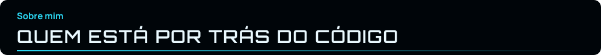
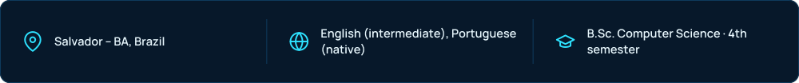
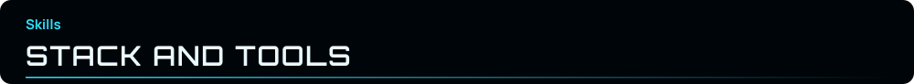
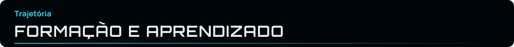
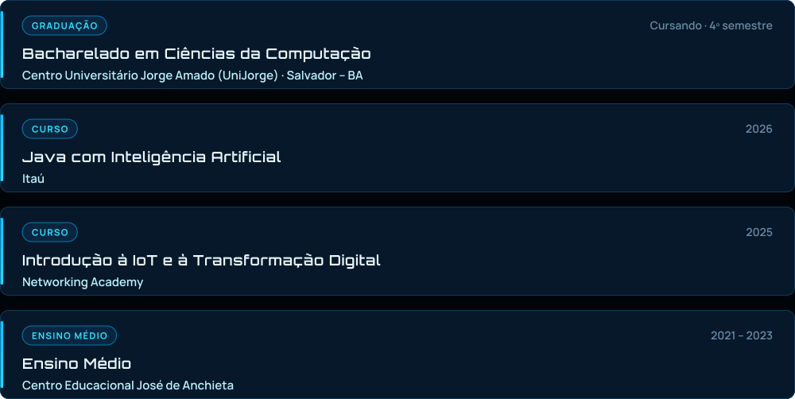
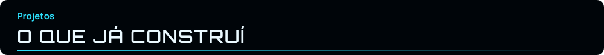
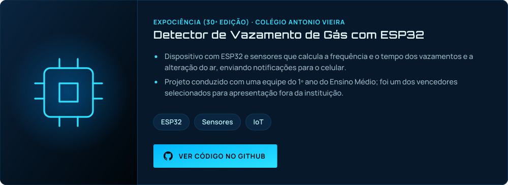
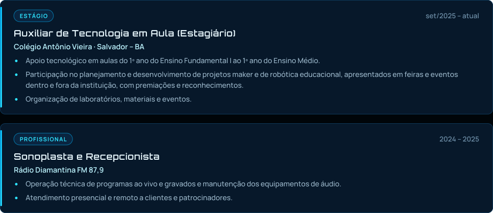

 

Sou estudante de Ciências da Computação, em busca de estágio em desenvolvimento de software. Tenho base em lógica de programação e estruturas de dados, com Java, C, JavaScript e Python, e experiência prática em robótica e IoT (ESP32 e Arduino), sistemas web e atuação em ambiente educacional.

Uso ferramentas de IA (Claude Code, ChatGPT e OpenCode) para acelerar o desenvolvimento e validar soluções. Estou em aprendizado contínuo e quero me desenvolver como profissional, usando a tecnologia para conectar pessoas e resolver problemas reais.

 

 

 

 

 

  

