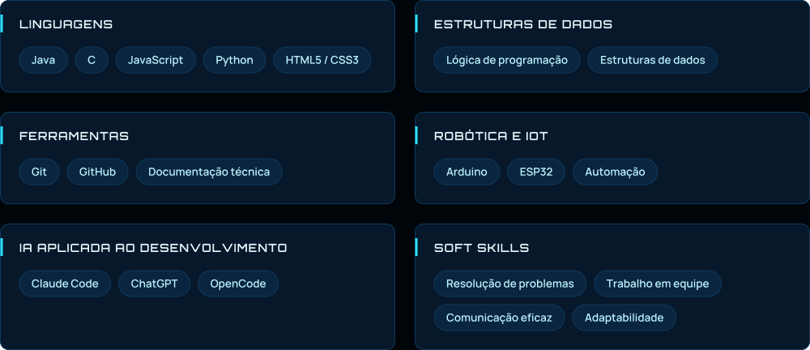

 

I'm a Computer Science student looking for a software development internship. I have a foundation in programming logic and data structures with Java, C, JavaScript and Python, plus hands-on experience in robotics and IoT (ESP32 and Arduino), web systems and educational environments.

I use AI tools (Claude Code, ChatGPT and OpenCode) to speed up development and validate solutions. I'm always learning and want to grow as a professional, using technology to connect people and solve real problems.

 

 

  

